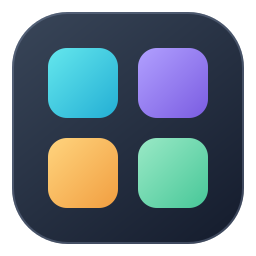
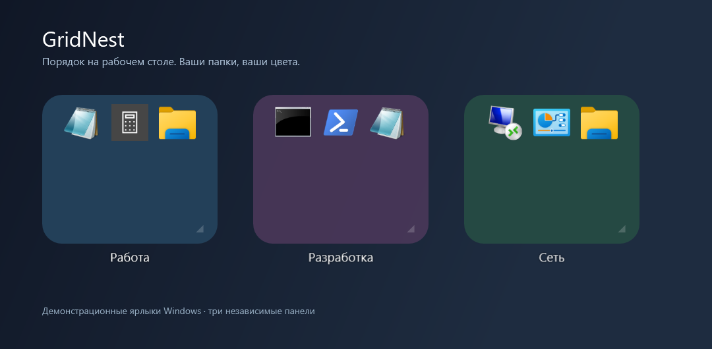
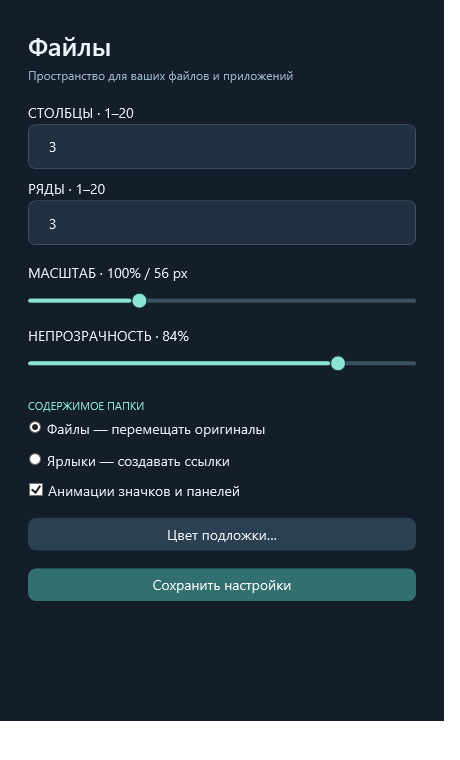
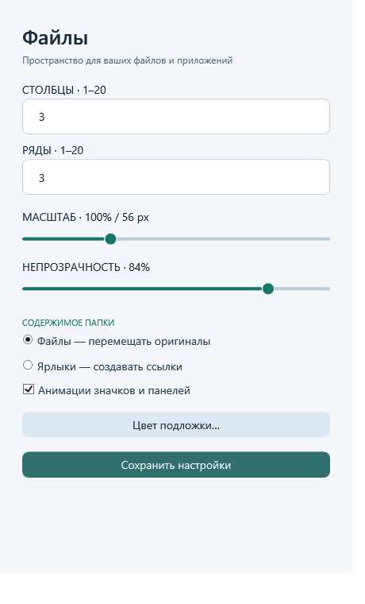

<h1 align="center">GridNest</h1>

Полупрозрачные папки для ярлыков и файлов Windows.

C# / WPF · Бесплатно · MIT

  <a href="https://github.com/AdreanHoyk/GridNest/releases/latest/download/GridNest-Setup.exe">Скачать EXE</a> ·
  <a href="https://github.com/AdreanHoyk/GridNest/releases/latest/download/GridNest.zip">Скачать ZIP</a> ·
  <a href="https://adreanhoyk.github.io/GridNest/">Сайт</a> ·
  <a href="https://github.com/AdreanHoyk/GridNest/releases">Релизы и изменения</a>

GridNest собирает обычные ярлыки, файлы и вложенные папки в отдельные панели. Размер задаётся целыми ячейками, значки можно расставлять вручную, а оформление — применить к одной папке или ко всем.

## Возможности

- **Сетка и порядок.** Равные внутренние отступы, сохранение ячеек и свободных промежутков. Перенос вставляет значок со сдвигом остальных; команда «Размещение → Выровнять значки в этой папке» убирает пустые ячейки с сохранением порядка. Полоса прокрутки располагается сбоку и не сдвигает значки.
- **Ярлыки и файлы.** Перенос между панелями, переименование с сохранением расширения, хранение оригиналов или создание ссылок.
- **Оформление.** Цвет и прозрачность с живым предпросмотром. Темы значков «Мягкое стекло», «Пастель» и исходные значки.
- **Обводка.** Цвет, толщина и сила свечения. Направления внутрь, наружу и с обеих сторон, отдельная пульсация.
- **Общий стиль.** Копирование оформления, применение к выбранным папкам или всем, стиль для новых папок.
- **Управление.** Компактное меню, вкладки настроек, поиск по всем папкам и отмена последнего действия.
- **Размещение.** Предпросмотр позиции, закрепление панелей и выбор отступа — 0, 8 или 16 DIP. Вертикальный промежуток настраивается отдельно, по умолчанию 8 DIP. Можно разрешить наложение.
- **Рабочий стол и архив.** Панель можно убрать с переносом содержимого на рабочий стол или сохранить в архиве. Совпадающие имена получают номер.
- **Трей.** Один значок для управления всеми папками. Светлая, тёмная и системная тема окон и меню.

- **Перенос с изображением.** Значок следует за курсором, исходная ячейка приглушается.
- **Обновления.** Проверка GitHub Releases и скачивание установщика из трея или настроек, с проверкой SHA-256.
- **Сенсорные жесты.** Касание, прокрутка, удержание для переноса, перемещение и изменение размера панели.

## Интерфейс

Настройки папки разделены на вкладки **Вид**, **Обводка**, **Значки** и **Папка**. Кнопки сохранения и отмены остаются внизу окна.

| Тёмная тема | Светлая тема |
| --- | --- |
|  |  |

[Настройки свечения](docs/outline.png) · [Контекстное меню](docs/menu.png)

## Установка

### EXE

1. [Скачайте GridNest-Setup.exe из последнего релиза](https://github.com/AdreanHoyk/GridNest/releases/latest/download/GridNest-Setup.exe).
2. Выберите автозапуск и нажмите **Установить / Обновить**.
3. Перетащите ярлыки на панели. Правый щелчок по фону открывает меню.

Установка выполняется для текущего пользователя. Права администратора не нужны. При обновлении пользовательские папки и настройки сохраняются. Если старая версия не завершается автоматически, выйдите из неё через трей и повторите установку.

Новая установка создаёт одну папку **«игры»** с исходным стилем значков. Существующие папки сохраняются при обновлении.

### ZIP

1. [Скачайте GridNest.zip](https://github.com/AdreanHoyk/GridNest/releases/latest/download/GridNest.zip) и распакуйте целиком.
2. Откройте PowerShell в папке с файлами и выполните

       powershell.exe -NoProfile -ExecutionPolicy Bypass -File .\Install.ps1

Для установки без автозапуска добавьте -NoStartup. Bypass действует только для этого запуска PowerShell.

Установщик и приложение пока не подписаны цифровым сертификатом.

## Управление

| Действие | Как выполнить |
| --- | --- |
| Настройки папки | Оформление → Настроить папку |
| Цвет и прозрачность | Оформление → Настроить папку → Вид |
| Обводка, направление и пульсация | Настройки папки → Обводка |
| Общий стиль | Оформление → Применить к другим |
| Размер | Нижний правый угол или Настройки папки → Папка |
| Масштаб значков | Настройки папки → Значки или Ctrl + колесо мыши |
| Перемещение панели | Тянуть нижний маркер, название или свободный фон |
| Отмена текущего переноса | Esc |
| Поиск | Ctrl + F в активной панели или меню трея |
| Отмена последнего действия | Ctrl + Z в активной панели или меню трея |
| Переименование значка | Меню значка или F2 |
| Создание и переименование папки | Подменю Папка |
| Вернуть содержимое на рабочий стол | Папка → Убрать папку → На рабочий стол |
| Архивирование | Папка → Убрать папку → В архив |
| Закрепление и отступы | Настройки приложения → Размещение папок |
| Общая тема | Настройки приложения → Тема приложения |

В режиме **Файлы** оригиналы перемещаются внутрь панели. В режиме **Ярлыки** для обычных внешних файлов создаются ссылки. Готовые ярлыки с рабочего стола перемещаются в обоих режимах. Смена режима не преобразует уже добавленное содержимое.

При переносе на рабочий стол панель убирается после успешного перемещения всех пользовательских объектов. Если операция завершилась частично, оставшиеся объекты доступны в панели и перенос можно повторить. Настройки и служебные файлы убранной панели сохраняются в архиве.

## Данные

- Папки и файлы хранятся в **Документы\GridNest**. Фактический путь определяется Windows и может находиться в OneDrive.
- Настройки приложения и отдельных папок находятся в .app.
- Порядок значков записывается в скрытый .gridnest-order.xml внутри каждой папки.
- Архив находится в .archive.

Файлы обрабатываются локально. По команде «Проверить обновления…» приложение обращается к GitHub Releases, показывает новую версию и описание изменений. «Скачать и обновить» проверяет SHA-256 и открывает установщик. Внешние приложения, открываемые через ярлыки, работают самостоятельно.

## Сенсорное управление

Касание открывает значок, свайп прокручивает папку. Удерживайте значок около половины секунды для переноса. Удержание с отпусканием без смещения открывает его меню. Панель перемещается за название или нижний маркер, размер меняется за угловой маркер. Сенсорные сценарии проверены моделируемыми событиями WPF, физический сенсорный экран требует отдельной проверки.

## Сборка

Требуются Windows, системный .NET Framework с WPF и компилятор C#. Сторонние пакеты для сборки не используются.

    .\Build.ps1
    .\Test.ps1
    .\Build-Setup.ps1

Перед Test.ps1 завершите GridNest через трей. Проверки используют отдельный временный каталог и не запускают пользовательские приложения. Build-Setup.ps1 создаёт ZIP и EXE-установщик.

GitHub Actions собирает пакеты. При публикации новой версии создаётся GitHub Release с файлами и описанием из RELEASE_NOTES.md.

## Ограничения

Приложение разрабатывается и проверяется в Windows 11. Совместимость со всеми версиями Windows, разными DPI и несколькими физическими мониторами не заявляется. Размещение учитывает рабочую область монитора, но несколько экранов с разным масштабом требуют отдельной проверки.

Подложка полупрозрачная, без Acrylic-размытия. Окна и полноэкранные приложения могут скрывать панели. Для некоторых интернет-ссылок Windows возвращает общий значок браузера.

## Удаление

Выйдите из приложения через трей. Удалите ярлык GridNest из автозапуска (shell:startup) и меню «Пуск», затем удалите .app из папки GridNest в документах. Папки с личными файлами, архив и резервные копии можно сохранить.

## Лицензия

[MIT](LICENSE.txt) для кода и собственных ресурсов проекта. На скриншотах показаны демонстрационные ярлыки Windows, их значки принадлежат правообладателям. GridNest не связан с Microsoft.

В меню значка доступно «Удалить в корзину…» (Delete) с подтверждением. Удалённые объекты восстанавливаются через корзину Windows. Ярлык удаляется отдельно от его цели.
Маркер изменения размера встроен в нижний правый угол папки и показывается при наведении. Все параметры папки, включая цвет и прозрачность, доступны через «Оформление → Настроить папку…».

Перенос в пустую ячейку сохраняет позиции остальных значков. Сдвиг выполняется при вставке на занятое место.

МИНИАТЮРЫ И ЭКРАНЫ
Изображения в папках показывают миниатюры содержимого. Проверены JPG и PNG; прочие форматы, видео и PDF зависят от обработчиков Windows. При недоступной миниатюре остаётся значок файла.
Положение сохраняется относительно монитора. Размещение → Выровнять папки на экране: выбрать экран; общее выравнивание работает отдельно на каждом экране.
Папки и значки переносятся между экранами. Разный физический DPI ещё требует проверки; автоматический возврат после отключения монитора не добавлен.
